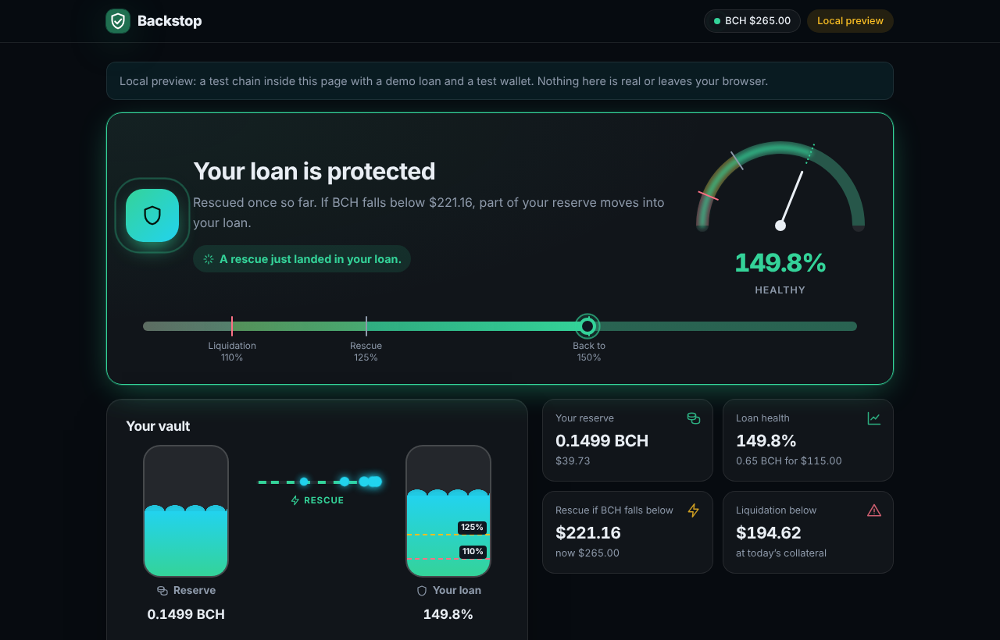
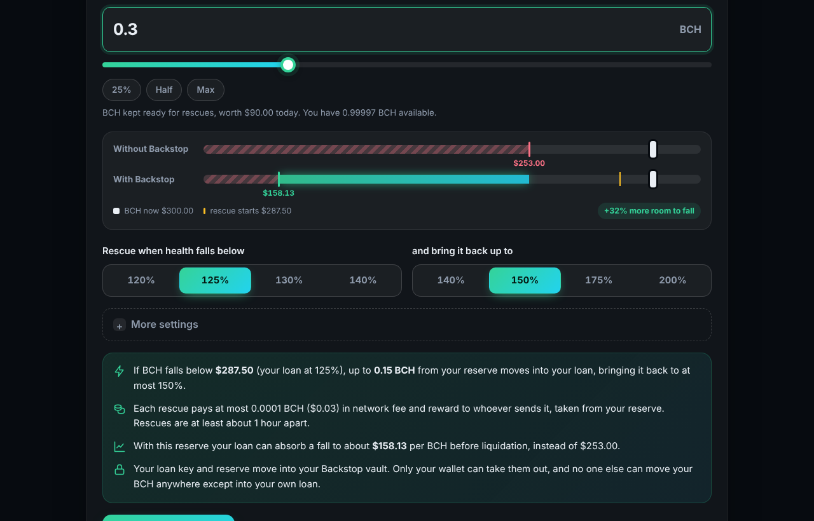
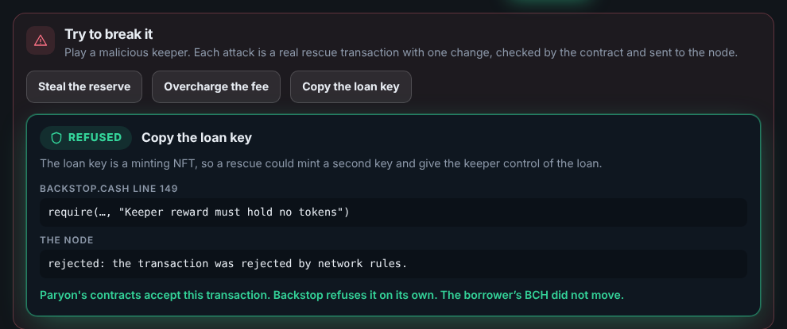

# Backstop

[](https://github.com/Emediong-Etuk/Backstop/actions/workflows/ci.yml)

**A pre-funded rescue for ParyonUSD loans on Bitcoin Cash.** The borrower puts their loan key and a BCH reserve into a vault, once. When the loan nears liquidation, **anyone** can send a rescue that moves part of the reserve into the borrower's own loan, with no signature from the borrower. One rule is enforced by the covenant itself: **the reserve can only ever go into this borrower's own loan, within the limits they set.** It has run end to end on chipnet.

**[Try it live](https://emediong-etuk.github.io/Backstop/?preview)** (no wallet needed) · **[Pitch video, 2 min](docs/video/media/backstop-pitch.mp4)** · **[Technical walkthrough, 4 min](docs/video/media/backstop-technical-walkthrough.mp4)** · BCH BLAZE 2026



## Judges, start here

No wallet, keys or funds needed for steps 1–4.

1. **Do:** open the [live preview](https://emediong-etuk.github.io/Backstop/?preview). **See:** a demo ParyonUSD loan at 130% (0.5 BCH for $115 at $300/BCH, liquidated below $253) and a test wallet, on a test chain inside the page.
2. **Do:** click **Protect my loan**. **See:** the loan key and a reserve move into the vault, with one signature (signed by the test wallet).
3. **Do:** under **Try to break it**, click **Copy the loan key**. **See:** *Refused*, `Backstop.cash` line 149, and the node rejecting the transaction. Paryon's own contracts would accept this attack; Backstop alone stops it. Try the other two attacks too.
4. **Do:** click **Price to $265**, then **Run a keeper**. **See:** the loan falls to 115%, a keeper with no keys rescues it, and it is back near 150%, with *Rescued* in the history.
5. **Do:** open the [rescue on chipnet](https://chipnet.imaginary.cash/tx/24aa5b20a23bcf3910cc72b004307127ee18460c1e5f1f8eb9f7a67a2dc0d399). **See:** the same transaction on the real chain: six inputs (Paryon's four contracts and the two vault outputs), confirmed, nothing signed by the borrower.
6. **Do:** `npm install && npm test`. **See:** 164 tests pass, every rescue attack run twice: against Paryon's real contracts, and with Paryon's checks removed, failing on Backstop's own `require`.
7. **Do:** read [`docs/MUTATION.md`](docs/MUTATION.md). **See:** each of the contract's 55 `require`s switched off in turn: 54 caught by a named test, and the one that cannot be (it duplicates another check from the other vault input) explained.

## The problem, in numbers

A borrower locks 0.5 BCH and borrows $115 of ParyonUSD at $300 per BCH: 130% collateral. Below 110%, at $253 per BCH, the loan is liquidated and **all 0.5 BCH is gone**. A 16% drop overnight is enough. Today the only defence is to be awake, watching, with spare BCH ready to add by hand.

With Backstop and a 0.3 BCH reserve, a rescue starts below $287.50 (125%), lifts the loan back to 150%, and the loan can absorb a fall to about $158 instead of $253. Nobody has to be awake.

## Proof: the run on chipnet

Paryon's unmodified contracts, one demo loan, a setup and withdraw signed in Cashonize over WizardConnect, and a rescue sent by the keeper CLI. 12–13 November 2026, all confirmed. To fit one faucet request, this run used a $30,000 demo price and a 0.005 BCH loan; the ratios are the same as above.

| Transaction | What happened | Block | Explorer |
|---|---|---|---|
| Demo deployment | Paryon's price contract, manage function, demo loan and loan key | 332,084 | [b6bdb31f…](https://chipnet.imaginary.cash/tx/b6bdb31f8622c03ad0eb3ac1ae686f66afce6586e5a5f1e74d082d2224d8e67f) |
| Setup | Loan key and a 0.003 BCH reserve into the vault, one signature | 332,087 | [ff1affd3…](https://chipnet.imaginary.cash/tx/ff1affd37f70464bf994d4129b510fd9427cbe290fc349775855828611b0cca7) |
| Price update | Demo oracle: $30,000 → $26,500, the loan falls to 115% | 332,087 | [cb31f9f0…](https://chipnet.imaginary.cash/tx/cb31f9f0a064dbc4a92712925af7d6b9e42f84424e3e0c35280f5129a3f310e7) |
| **Rescue** | 0.0015 BCH from the reserve into the loan, back to 149.8%, no signatures | 332,088 | [24aa5b20…](https://chipnet.imaginary.cash/tx/24aa5b20a23bcf3910cc72b004307127ee18460c1e5f1f8eb9f7a67a2dc0d399) |
| Withdraw | Loan key and the rest of the reserve back to the borrower, one signature | 332,088 | [962af902…](https://chipnet.imaginary.cash/tx/962af902b19aa1df7b86db3eb4f7b15fc612f51dec2ef8829ff6ba34cdb78aab) |

Each link opens the transaction on the chipnet explorer. The deployment is in [`deployments/chipnet.json`](deployments/chipnet.json); with the setup ID above in `keeper/vaults.json`, `npm run demo:links` rebuilds this table from the chain.

## What makes it safe, and Bitcoin Cash native

- **Safety enforced on chain.** Every guarantee is a `require` in [`contracts/Backstop.cash`](contracts/Backstop.cash); [ARCHITECTURE.md](docs/ARCHITECTURE.md#every-guarantee-is-a-require) maps each one to its line and its test. A malicious keeper building the transaction by hand can only perform the rescue as the borrower set it up.
- **No friction.** One signature to set up, none during a rescue, one to withdraw. No account, server or database. The rescue's fee comes from the reserve, within a cap the borrower sets.

| Bitcoin Cash feature | What it does here | Where |
|---|---|---|
| CashScript covenant (P2SH32) | The vault: `rescue()` for anyone, `ownerSpend` / `ownerWithdraw` for the borrower | [`contracts/Backstop.cash`](contracts/Backstop.cash), [`contracts/src/vault.ts`](contracts/src/vault.ts) |
| Transaction introspection | Pins the exact rescue: 6 inputs, ≤7 outputs, each one's script, token and value | `Backstop.cash:58-150` |
| CashTokens | Identifies the loan key (a minting NFT) and Paryon's contracts; reads the loan's debt and the price from NFT commitments; forbids minting a copy of the key | `Backstop.cash:68, 79-99, 149` |
| `checkDataSig` oracle prices | The rescue reads Paryon's price contract, which accepts only oracle-signed, newer prices: no fake or replayed price | Paryon's `PriceContract`; [`test/price.test.ts`](test/price.test.ts) |
| BIP68 relative timelock (`this.age`) | A cooldown between rescues, enforced by every node | `Backstop.cash:75`; [`test/node.test.ts`](test/node.test.ts) |
| Large script integers (2025 upgrade) | Ratio checks cross-multiplied, no division | `Backstop.cash:153-165` |
| `OP_RETURN` | The setup publishes every vault rule, so anyone can rebuild the vault from the chain | [`contracts/src/vault.ts`](contracts/src/vault.ts) |
| WizardConnect / WalletConnect | Wallet signing from a static site, no backend | [`web/lib/wizardconnect.ts`](web/lib/wizardconnect.ts), [`web/lib/walletconnect.ts`](web/lib/walletconnect.ts) |
| XO template | The vault's three actions for the XO debug tool | [`xo/`](xo/README.md) |

Docs: [`docs/ARCHITECTURE.md`](docs/ARCHITECTURE.md) (technical walkthrough, guarantee → `require` → test), [`docs/DEMO_SCRIPT.md`](docs/DEMO_SCRIPT.md) (the pitch), [`docs/MUTATION.md`](docs/MUTATION.md) (each `require` switched off, and the test that catches it), [`docs/PHASE0.md`](docs/PHASE0.md) (research on Paryon, the oracle and XO).

## Quick start from a clean clone

Requires Node 22+.

```bash
npm install
```

```bash
npm test
```

`npm test` compiles the covenant and runs 164 tests. They use **Paryon's real compiled contracts** (`@paryonusd/contracts@1.1.0`), on two networks:

- CashScript's mock network;
- `@paryonusd/mem-cash`, an in-memory node that checks relative timelocks, standardness and fees the way BCHN does.

Run the app locally without a wallet or network:

```bash
npm run web:dev
```

Then open http://localhost:3000/?preview: the same local preview as the live link. The whole flow, including the attacks, runs headless on desktop and phone sizes with `npm run web:e2e` (needs Playwright with Chromium); CI runs it on every push.

| Setting up: the reserve and what it buys | An attack, refused |
|---|---|
|  |  |

## How it works

The vault is two outputs at one `Backstop.cash` address:

- a **key UTXO**: 1000 sats plus the loan's minting loan key;
- a **reserve UTXO**: BCH only.

They are separate because Paryon requires the loan key to come back with exactly the value it went in with (`manage.cash:121`).

A rescue is Paryon's own add-collateral transaction (`manage` with no repayment), with the vault at inputs 4 and 5:

```
in 0  Paryon price contract     out 0  price contract, unchanged
in 1  Paryon loan               out 1  loan, same state, collateral + top-up
in 2  Paryon loan sidecar       out 2  sidecar, unchanged
in 3  Paryon manage function    out 3  manage function, unchanged
in 4  vault key                 out 4  vault key, unchanged
in 5  vault reserve             out 5  vault reserve, minus top-up and capped overhead
                                out 6  optional keeper reward (BCH only)
```

The rescue reads the price from Paryon's price contract at input 0. That contract accepts only oracle-signed, newer prices. So the rescue triggers on exactly the price Paryon would liquidate at, and an old low price cannot be replayed.

## Threat model

| Party | Can | Cannot (enforced by) |
|---|---|---|
| **Keeper** (anyone) | Broadcast a rescue while the loan is below the trigger; take a reward within the fee cap | Steal or copy the loan key, withdraw collateral, raise debt, change the interest manager, top up another loan, overfund past the target, drain the reserve with tiny rescues, rescue before the cooldown. All by `Backstop.cash` `require`s; see [ARCHITECTURE.md](docs/ARCHITECTURE.md#every-guarantee-is-a-require) |
| **Web app / frontend** | Build transactions for the wallet to sign | Move funds without the borrower's signature. A malicious frontend could ask the borrower to sign a bad setup or withdraw, like any dapp; once funds are in the vault, the covenant decides. The site is static, holds no keys and stores nothing. |
| **Borrower** | Withdraw the key and the whole reserve at any time with one signature | — |
| **Anyone else** | Nothing beyond what a keeper can do | Withdraw from the vault (`ownerSpend` checks the owner's key hash and signature; `ownerWithdraw` needs one of the owner's own coins, signed by the owner, and pays only the owner's address) |
| **Oracle** | Sign prices. A wrong price triggers (or withholds) a rescue, exactly as it would trigger (or withhold) a liquidation | Move funds anywhere but into the borrower's own loan |
| **Paryon team** (migration key) | Migrate the price contract code, as for every Paryon user | Take vault funds; Backstop pins the price contract's output unchanged |
| **Miners** | Delay or reorder transactions | Change what a rescue may do |

Residual risks:

- **A stale price.** No rescue happens, but no liquidation happens either.
- **A keeper choosing the most out-of-date of several price threads.** Limited by the target ratio, the cooldown, and the fact that money goes only into the borrower's own loan.
- **A crash faster than any keeper, or within the cooldown.** The stability pool can still liquidate first.
- **Redemptions**, which are out of scope.

## What is real and what is simulated

| Piece | Real | Simulated or demo-only |
|---|---|---|
| Backstop covenant | The same compiled contract in the tests, the preview and on chipnet | — |
| Paryon contracts | Paryon's **unmodified** Loan, LoanSidecar, manage and PriceContractGuarded bytecode (`@paryonusd/contracts@1.1.0`) | There is no public Paryon chipnet deployment, so we deployed that bytecode under our own token categories (`oracle-demo/src/deploy.ts`). Demo loans are created at genesis, not through `borrow`. Borrowing, the stability pool and liquidation are not deployed. |
| Price feed | Real General Protocols message format, verified by Paryon's price contract with `checkDataSig` | On chipnet the oracle key is a **demo key we control**, so the price can fall on camera. Mainnet would use General Protocols' key `02d09db08af1ff4e8453919cc866a4be427d7bfe18f2c05e5444c196fcf6fd2818`. The app labels the demo price feed. |
| Chain | The chipnet run above: five confirmed transactions | The **live preview** runs a test chain inside the page (`@paryonusd/mem-cash`) with a test wallet; it is labelled on screen. |
| Amounts | The preview uses 0.5 BCH at $300 | The chipnet run used a $30,000 demo price and a 0.005 BCH loan, to fit one faucet request. |
| Wallets | Cashonize over WizardConnect signed the chipnet setup and withdraw | WalletConnect has not been tried with a wallet. `test/wizardconnect.test.ts` pairs the app with `@wizardconnect/wallet`'s connection manager over a local relay. |
| Keeper | The real CLI sent the chipnet rescue, holding no keys | It finds vaults from setup transaction IDs in `keeper/vaults.json`, not an indexer: I could not confirm a chipnet ChainGraph instance. Each vault's rules still come from its on-chain setup `OP_RETURN`. |
| XO template | XO's own parser and compiler produce Backstop's and Paryon's exact bytecode (`test/xo.test.ts`) | Not run in the XO engine or debug tool; see [`xo/README.md`](xo/README.md). |
| Videos | Recorded from the real app and the real chipnet explorer | The app scenes use the live preview; the narration is a synthesized voice (Kokoro). |

Also: **one loan per vault.** Topping up the reserve means withdrawing and setting up again.

## Run the demo on chipnet

These steps need a normal internet connection (Electrum over WebSocket). The recording sequence is in [`docs/DEMO_SCRIPT.md`](docs/DEMO_SCRIPT.md).

**Check the chipnet servers first.** A server whose node has fallen off the network keeps answering, but no new block arrives there and nothing sent through it confirms. Compare the servers:

```bash
npm run demo:servers
```

Then put a server that is on the newest block in `.env` as `CHIPNET_ELECTRUM_SERVER`. The demo scripts, the keeper and the web app all use it. Fund your addresses from a faucet whose node is on the same chain. On 12 November 2026 the `chipnet.bch.ninja` server and faucet were on their own branch, at block 331,985 while chipnet was past 332,075: what was sent through them never reached chipnet.

1. Create demo keys in `.env`, which git ignores:

   ```bash
   npm run demo:keys -- --write
   ```

2. Fund the printed addresses from a chipnet faucet whose node is on the newest block: about 1.2 tBCH for the funder and 0.6 tBCH for the borrower (or about a tenth of that with the smaller demo below).

3. Deploy Paryon's add-collateral contracts with two demo loans (0.5 BCH collateral, $115 debt, at $300/BCH, so 130%). Add `--borrower-address <bchtest:z…>` to send the loan keys to a Cashonize wallet.

   ```bash
   npm run demo:deploy
   ```

   **Short of test BCH?** Paryon's minimum debt is in dollars ($100), so a higher demo price shrinks every BCH amount and keeps the same ratios. This needs about 0.07 tBCH for the funder and 0.06 for the borrower (`test/demo.test.ts` runs it):

   ```bash
   npm run demo:deploy -- --price 3000 --loans 1 --collateral 0.05
   ```

   Then use a 0.05 BCH reserve, and crash to `--price 2650` instead of 265.

   With only one faucet request (1,000,000 sats) per address, go one step further: `--price 30000 --collateral 0.005`, a 0.005 BCH reserve, and crash to `--price 26500`.

   If only the funder got coins, it can pay the borrower's wallet from what the deploy leaves (`test/demo.test.ts` runs this with a single 1,000,000-sat faucet request):

   ```bash
   npm run demo:fund -- --to <wallet address> --amount 0.004
   ```

   Then use a 0.003 BCH reserve.

4. Either set up through the web app (`npm run web:dev`, with `NEXT_PUBLIC_WC_PROJECT_ID` in `.env`), or with the scripted borrower:

   ```bash
   npm run demo:setup -- --loan 0 --reserve 0.5
   ```

   Then wait one block for the cooldown.

5. Start the keeper in another terminal:

   ```bash
   npm run keeper -- --watch --interval 15
   ```

6. Crash the price, then check status and withdraw:

   ```bash
   npm run demo:crash -- --price 265
   ```

   ```bash
   npm run demo:status
   ```

   ```bash
   npm run demo:withdraw
   ```

7. Print the transactions as a Markdown table for `docs/ARCHITECTURE.md`:

   ```bash
   npm run demo:links
   ```

`deployments/chipnet.json` holds no secrets; commit it so the web app and others can find the deployment.

## Keeper

```bash
npm run keeper -- --dry-run
```

```bash
npm run keeper -- --watch
```

The keeper is stateless. It needs no private key and no funds. `--dry-run` prints the rescue it would send (inputs, outputs, ratio before and after, raw hex) and broadcasts nothing. It checks each transaction locally before broadcasting and waits out each vault's cooldown. Options: `--fee-rate`, `--reward-sats`, `--server` (default: `CHIPNET_ELECTRUM_SERVER` from `.env`, else `chipnet.imaginary.cash`), `--deployment`, `--vaults`. Set `KEEPER_REWARD_ADDRESS` in `.env` to collect rewards.

## Web app

A static Next.js site (`web/`), with three screens. With WizardConnect, the app reads the wallet's receive and change addresses from its xpubs and finds the used ones from chain history; it then tells the wallet which key signs each input.

- **Connect:** WizardConnect (HD wallets, no setup needed) or WalletConnect (chain `bch:bchtest`, for wallets such as Cashonize).
- **Set up:** finds the loan whose key is in the wallet, shows its health and liquidation price, and explains what a rescue will do. One signature.
- **Status:** reserve, rescue and liquidation prices, rescue history from the chain, and *Withdraw everything*.
- **Local preview only:** controls for the price feed, the miners and a keeper, and **Try to break it**: three attacks a malicious keeper could try (steal the reserve, overcharge the fee, copy the loan key). Each is a real rescue transaction with one change; the app shows the `require` that refuses it and the node's rejection (`contracts/src/attacks.ts`, `test/attacks.test.ts`).

To build the site:

```bash
npm run web:build
```

This writes `web/out/`, which you can host anywhere; `.github/workflows/pages.yml` publishes it to GitHub Pages on every push to `main`. It reads `deployment.json` next to `index.html` at runtime. Configuration is in `.env` (see `.env.example`): `NEXT_PUBLIC_WC_PROJECT_ID` (free from https://dashboard.reown.com) and optionally `CHIPNET_ELECTRUM_SERVER`.

## XO template

`xo/backstop.template.json` expresses the vault's three actions (protect, rescue, withdraw) as an XO template for the XO debug tool. It is generated from the compiled contracts with `npm run xo:export`; `npm run xo:values -- <setup txid>` prints a real vault's values for it. Details and limits: [`xo/README.md`](xo/README.md).

## Repository layout

```
contracts/    Backstop.cash, compiled artifact, shared TypeScript helpers (@backstop/contracts)
keeper/       stateless keeper CLI (@backstop/keeper)
oracle-demo/  DEMO ONLY: demo oracle, chipnet deployment, demo scripts, local chain (@backstop/demo)
web/          static web app (Next.js, WalletConnect, local preview)
xo/           the vault as an XO template (backstop.template.json) for the XO debug tool
test/         Vitest suite on the mock network and mem-cash
deployments/  where the demo deployment lives on chipnet (written by demo:deploy)
docs/         research, architecture, demo script; docs/phase0/probe is the composition probe
```

No private keys are committed. Keys live in `.env`; see `.env.example`.

WizardConnect support uses `@wizardconnect/core` and `@wizardconnect/dapp` (LGPL-3.0) as unmodified npm dependencies.

## Prior work and AI assistance

- **When it was built.** Development started on 10 November 2026, before BCH BLAZE's hacking period (14–22 November). Every commit is dated in the git history.
- **AI assistance.** The code, tests and documentation were written with Claude Code (Anthropic), working from the author's specification and direction; commits carry a `Co-Authored-By` trailer. The author ran the chipnet demo with their own wallet.
- **Third-party code, used unmodified as npm dependencies:** Paryon's contracts and `mem-cash` (`@paryonusd/*`), CashScript, libauth, General Protocols' price-oracle library, `@wizardconnect/core` and `@wizardconnect/dapp` (LGPL-3.0), WalletConnect, Next.js. The video narration uses Kokoro (Apache-2.0).

## License

MIT, see [`LICENSE`](LICENSE).
