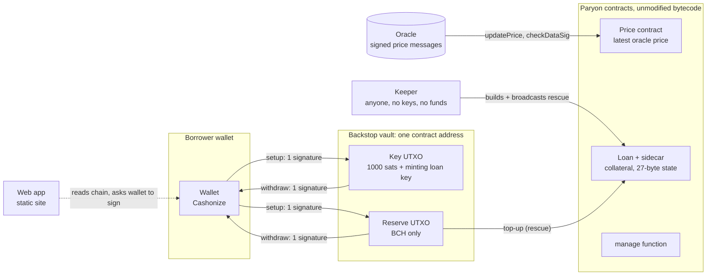

# Backstop architecture

For the five-minute technical walkthrough. Line numbers refer to `contracts/Backstop.cash`. Test names are quoted from `test/`.

## The pieces



- **Vault.** Two UTXOs at one `Backstop.cash` address. They are separate because Paryon's `manage` requires the loan key to come back with exactly the BCH value it went in with (`manage.cash:121`), so the key UTXO cannot also hold a shrinking reserve.
- **Paryon.** Paryon's add-collateral path is `manage(repayAmount = 0)`. Its layout is fixed at inputs and outputs 0–4 (price contract, loan, sidecar, manage function, loan key) and leaves index 5 and above free. That free space is where Backstop's reserve and the keeper's reward go.
- **Price.** The rescue reads the price from Paryon's own price contract at input 0. That contract accepts only messages signed by its oracle key (`checkDataSig`, `PriceContract.cash:46`) and only newer sequence numbers (`PriceContract.cash:77`). So a rescue happens at exactly the price Paryon would liquidate at, and an old price cannot be replayed.
- **Keeper.** A stateless process (`keeper/`) that holds no keys and no funds. It rebuilds each vault from its setup OP_RETURN, finds the loan and the freshest price, and broadcasts a rescue. Anyone can run one. A malicious keeper can only ever send a correct rescue.
- **Web app.** A static site (`web/`). It reads everything from the chain and asks the wallet to sign over WalletConnect.

## The three transactions

### 1. Setup: one wallet signature

```
in   wallet: loan key (minting NFT)      out 0  vault key UTXO: 1000 sats + loan key
in   wallet: BCH coin(s)                 out 1  vault reserve UTXO: the reserve
                                         out 2  OP_RETURN "BKSP" <all vault parameters>
                                         out 3  change to the wallet
```

The OP_RETURN holds every constructor parameter, so anyone can rebuild the vault's address and rules from chain data alone (`contracts/src/vault.ts`). The keeper's vault list holds only setup transaction IDs. The web app finds a borrower's vaults by scanning the borrower's own transaction history.

### 2. Rescue: anyone, no signatures

```
in 0  Paryon price contract (sharePrice)     out 0  price contract, unchanged
in 1  Paryon loan                            out 1  loan, same state, value + topUp
in 2  Paryon loan sidecar                    out 2  sidecar, unchanged
in 3  Paryon manage function                 out 3  manage function, unchanged
in 4  vault key UTXO        rescue()         out 4  vault key UTXO, unchanged
in 5  vault reserve UTXO    rescue()         out 5  vault reserve, >= in5 - topUp - maxOverhead
                                             out 6  optional keeper reward, BCH only
```

`rescue()` runs on both vault inputs. At input 4 it checks only that input 5 carries the same script (line 54). Input 5 is then either a rescue, so every check below runs, or an owner-signed spend. All rules are checked at input 5. About 2.5 KB; the fee comes out of the reserve, within `maxOverheadSats`.

### 3. Withdraw: one wallet signature

```
in   vault key UTXO      ownerSpend(pubkey, sig)    out 0  loan key to the wallet
in   vault reserve UTXO  ownerSpend(pubkey, sig)    out 1  reserve to the wallet
```

`ownerSpend` checks the key hash and the signature, nothing else (lines 172–173). The owner can always leave.

### On chipnet

Fill this table from a real run with `npm run demo:links`, which prints it from chain data:

| Transaction | What it does | Explorer |
|---|---|---|
| Demo deployment | *(run `npm run demo:links`)* | |
| Setup | | |
| Price update | | |
| Rescue | | |
| Withdraw | | |

## Every guarantee is a `require`

Each rescue test runs twice:

- against Paryon's real compiled contracts, where the transaction must fail;
- with Paryon's checks replaced by permissive stand-ins (`test/fixtures/PermissiveStandIn.cash`), where it must fail on Backstop's own `require`, matched by its message.

So none of these depends on Paryon catching the same mistake. Deleting a `require` turns its tests red; I checked this for four of them in Phase 1.

| A rescue cannot… | Backstop.cash | Test (`test/rescue.test.ts` unless noted) |
|---|---|---|
| smuggle in extra inputs (other tokens or authority) | 60 | an extra input smuggled into the rescue |
| add outputs that siphon value or carry tokens | 62 | an extra output siphoning value |
| use vault UTXOs anywhere but positions 4 and 5, or from different vaults | 54, 56, 66 | vault inputs placed anywhere but positions 4 and 5; `owner.test.ts`: nobody can take the reserve alone by calling the rescue path |
| use some other loan's key, or swap key and reserve | 68, 70 | vault inputs placed anywhere but positions 4 and 5 |
| run again before the cooldown | 75 (plus BIP68 at the node) | a rescue before the cooldown has passed; `node.test.ts`: the node refuses a rescue until the reserve is as old as the cooldown |
| use a fake price | 79, 81, 89 | a fake price contract reporting a low price |
| let a (migrated) price contract leak tokens or change state | 83–86 | (shape covered by every accepted rescue; no dedicated attack test) |
| top up someone else's loan | 94–99 | the top-up going into somebody else's loan |
| move the loan, raise its debt, repay with outside PUSD, or change its interest manager | 102–107 | a keeper increasing the loan's debt; a keeper making themselves the loan's interest manager |
| move or alter the sidecar | 109–111 | (Paryon also enforces this, `LoanSidecar.cash:21-24`; no dedicated attack test) |
| replace Paryon's manage function with another contract | 115–117 | some other contract standing in for Paryon's manage function |
| hide a key copy in the manage function's output | 119–121 | a keeper hiding a copy of the loan key in the manage function output |
| withdraw collateral | 128 | a keeper withdrawing collateral with the key |
| add more than the per-rescue limit | 130 | a top-up above the vault limit |
| keep the loan key, or return it changed | 134–137 | the loan key being sent anywhere but the vault; …coming back with a changed commitment; …coming back without its minting capability |
| send the remaining reserve elsewhere | 141–142 | the remaining reserve being sent anywhere but the vault |
| take more than the fee cap | 144 | fees plus keeper reward above the vault limit |
| mint a copy of the loan key (it is a minting NFT) | 149 | a keeper minting a copy of the loan key for themselves |
| rescue a loan that is not in danger, or replay a rescue | 156 | a rescue while the loan is not in danger; a second rescue at the same price once the loan is back above the trigger (replay) |
| overfund the loan | 158 | a top-up that lifts the loan above the target |
| drain the reserve through many tiny rescues | 165 | a keeper draining the reserve through many tiny rescues; may use the whole per-rescue limit even if that does not reach the target |
| be withdrawn by anyone but the owner | 172–173 | `owner.test.ts`: a stranger cannot withdraw with their own key; a stranger cannot withdraw by presenting the owner's public key with their own signature |

Three attacks that **Paryon's own contracts accept**, which only Backstop stops:
- minting a second loan key;
- changing the interest manager;
- withdrawing collateral while the loan stays above 110%.

The Phase 0 probe (`docs/phase0/probe/`) demonstrates all three against Paryon's real bytecode.

The price the rescue relies on is checked by Paryon's price contract: `test/price.test.ts` covers a correctly signed message, a wrong-key signature and a replayed old message. `test/story.test.ts` and `test/demo.test.ts` run the whole sequence end to end, the second on a node that checks BIP68, standardness and fees the way BCHN does.

## Units and integer arithmetic

- Collateral is in satoshis.
- Debt is in PUSD cents (2 decimals, `manage.cash:92`).
- The price is in US cents per BCH. Checked against the live General Protocols oracle: metadata `ATTESTATION_SCALING = 100`, USD per BCH.
- The ratio comparisons in lines 153–165 are cross-multiplied, with no division in the script: `collateral * price * 10000` against `ratioBps * debt * 1e8`. BCH script integers (2025 upgrade) are wide enough for this.
- `contracts/src/ratio.ts` mirrors the same arithmetic for the keeper and the web app.

## Known limitations

- **Price staleness.** A rescue uses whatever Paryon's price contract holds. If nobody updates it, no rescue happens, and no liquidation happens either, because Paryon liquidates on the same price. With several price threads, a keeper can choose the most out-of-date one. The target ratio, the cooldown, and the fact that the money only goes into the borrower's own loan limit what that achieves. On mainnet Paryon's operator keeps the threads fresh; the demo updates every thread.
- **Trust in Paryon's migration key.** Paryon's team can migrate the price contract code (`contract_overview.md:539`). Backstop requires the price contract output to come back unchanged (lines 83–86), but migrated code could still report a wrong price. Every Paryon user already carries this risk. The demo's price contract has no possible migration key.
- **Liquidation race.** If the price drops below 110% faster than a keeper acts, or within the cooldown, the stability pool can liquidate first. Backstop reduces this risk; it does not remove it. Paryon's own `manage` also refuses a top-up that leaves the loan below 110%.
- **Redemptions** are out of scope. A loan being redeemed against can still be topped up, but Backstop does not protect against redemption.
- **One loan per vault.** One reserve output per vault: topping up the vault means withdrawing and setting it up again.
- **Discovery.** For the demo, the keeper reads setup transaction IDs from a local JSON file. I could not confirm a chipnet ChainGraph instance to query OP_RETURNs starting with "BKSP".
- **Demo deployment.** There is no public Paryon chipnet deployment. Ours runs Paryon's unmodified Loan, LoanSidecar, manage and PriceContractGuarded bytecode under our own token categories. Demo loans are created at genesis rather than through `borrow`. Borrowing, the stability pool and liquidation are not deployed. The price comes from a demo oracle key.
